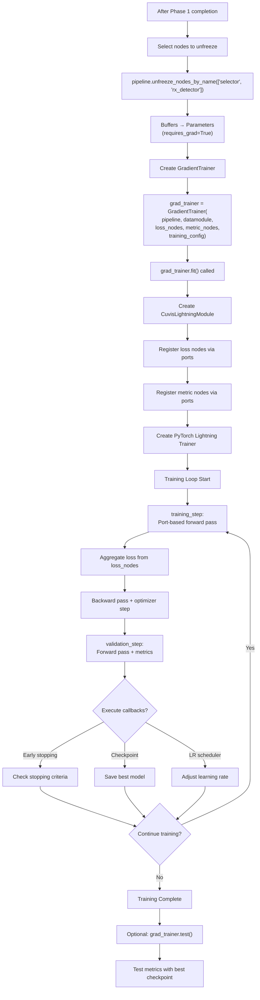

!!! warning "Status: Needs Review"
    This page has not been reviewed for accuracy and completeness. Content may be outdated or contain errors.

---

# Two-Phase Training

*Many pipelines use two phases: statistical initialization from initialization data, then optional gradient training via backpropagation.*

Two-phase training combines statistical methods and deep learning. **Phase 1** computes statistics fast and deterministically. **Phase 2** refines parameters via gradients for task-specific optimization.

**Phase 1 Benefits:**

* ⚡ Fast (seconds to minutes)
* 💾 Memory efficient
* 🎯 Strong initialization for Phase 2
* 🔒 Deterministic and reproducible

**Phase 2 Benefits:**

* 📈 Learns task-specific features
* 🎨 Flexible optimization objectives
* 🔬 Fine-grained parameter refinement

---

## Phase 1: Statistical Initialization

*Compute statistics from initialization data without gradients using [Welford's algorithm](https://www.johndcook.com/blog/standard_deviation/).*

### Statistical Training Lifecycle

This flowchart shows the complete Phase 1 training process, from trainer creation through validation:

```mermaid
flowchart TD
    A[Create StatisticalTrainer] --> B["stat_trainer = StatisticalTrainer(pipeline, datamodule)"]
    B --> C["stat_trainer.fit() called"]
    C --> D{Find nodes with<br/>requires_initial_fit?}
    D -->|Yes| E[Sort nodes by<br/>port connections]
    D -->|No| M[Skip Phase 1]
    E --> F[For each statistical node]
    F --> G[Get transformed data<br/>via port routing]
    G --> H["Call node.statistical_initialization(input_stream)"]
    H --> I[Accumulate statistics<br/>using Welford's algorithm]
    I --> J[Store as frozen buffers<br/>register_buffer()]
    J --> K["Call node.prepare_for_gradient_train()"]
    K --> L{More nodes?}
    L -->|Yes| F
    L -->|No| M[Statistical initialization complete]
    M --> N["Optional: stat_trainer.validate()"]
    N --> O[Validation metrics]
```

**Key Steps:**

1. **Trainer Creation:** Instantiate `StatisticalTrainer` with pipeline and datamodule
2. **fit() Execution:** Calls the statistical initialization process
3. **Node Discovery:** Finds all nodes with `requires_initial_fit=True`
4. **Topological Ordering:** Sorts nodes by port connections for proper data flow
5. **Per-Node Initialization:**
   - Routes data through preceding nodes via port connections
   - Calls `statistical_initialization()` with data stream
   - Accumulates statistics using Welford's online algorithm
   - Stores statistics as PyTorch buffers (frozen, non-trainable)
   - Prepares node for potential gradient training phase
6. **Validation (Optional):** Test initialized pipeline on validation set

### Loading Initialization Data

```python
from cuvis_ai_dataloader.data import Cu3sDataModule
from cuvis_ai_schemas.training.data import DataSplitConfig, Selector, SelectorKind

cu3s_path = "data/initialization/samples.cu3s"

datamodule = Cu3sDataModule(
    cu3s_file_path=cu3s_path,
    annotation_json_path="data/initialization/annotations.json",
    splits=DataSplitConfig(
        train=[Selector(kind=SelectorKind.FILE_INDICES, source=cu3s_path, ids=[0, 1, 2])],
        val=[Selector(kind=SelectorKind.FILE_INDICES, source=cu3s_path, ids=[3])],
        test=[Selector(kind=SelectorKind.FILE_INDICES, source=cu3s_path, ids=[4])],
    ),
    batch_size=4
)

datamodule.setup(stage="fit")
```

### Computing Statistics

```python
from cuvis_ai_core.training import StatisticalTrainer

stat_trainer = StatisticalTrainer(pipeline=pipeline, datamodule=datamodule)
stat_trainer.fit()  # Process all batches

# Nodes now initialized
rx_detector = {node.name: node for node in pipeline.nodes()}["rx_detector"]
assert rx_detector._statistically_initialized
```

### Statistical Nodes

#### RXGlobal (Anomaly Detection)

```python
from cuvis_ai.node.anomaly.rx_detector import RXGlobal

from cuvis_ai_core.training import StatisticalTrainer

rx_node = RXGlobal(num_channels=61, eps=1e-6)
# Nodes are added automatically when you wire them with pipeline.connect(...)

# Use StatisticalTrainer to initialize
trainer = StatisticalTrainer(pipeline=pipeline, datamodule=datamodule)
trainer.fit()  # Automatically calls statistical_initialization on rx_node

print(rx_node.mu.shape)      # (61,) - Background mean
print(rx_node.sigma.shape)   # (61, 61) - Covariance matrix
```

**Implementation Pattern:**
```python
def statistical_initialization(self, input_stream: InputStream) -> None:
    """Compute statistics using Welford's algorithm."""
    n = 0
    mean = torch.zeros(self.num_channels, dtype=torch.float64)
    M2 = torch.zeros((self.num_channels, self.num_channels), dtype=torch.float64)

    for batch_data in input_stream:
        data = batch_data["data"]
        flattened = data.flatten(0, 2).double()

        for sample in flattened:
            n += 1
            delta = sample - mean
            mean += delta / n
            delta2 = sample - mean
            M2 += torch.outer(delta, delta2)

    covariance = M2 / (n - 1) if n > 1 else M2
    self.register_buffer("mu", mean.float())
    self.register_buffer("sigma", covariance.float())
    self._statistically_initialized = True
```

#### MinMaxNormalizer

```python
from cuvis_ai.node.normalization import MinMaxNormalizer

from cuvis_ai_core.training import StatisticalTrainer

normalizer = MinMaxNormalizer(eps=1e-6, use_running_stats=True)
# Nodes are added automatically when you wire them with pipeline.connect(...)

# Use StatisticalTrainer to initialize
trainer = StatisticalTrainer(pipeline=pipeline, datamodule=datamodule)
trainer.fit()  # Automatically calls statistical_initialization on normalizer

print(normalizer.running_min)  # Global min values
print(normalizer.running_max)  # Global max values
```

#### SoftChannelSelector

```python
from cuvis_ai.node.channel_selector import SoftChannelSelector

from cuvis_ai_core.training import StatisticalTrainer

selector = SoftChannelSelector(
    n_select=10,
    input_channels=61,
    init_method="variance",
    temperature_init=5.0
)
# Nodes are added automatically when you wire them with pipeline.connect(...)

# Use StatisticalTrainer to initialize
trainer = StatisticalTrainer(pipeline=pipeline, datamodule=datamodule)
trainer.fit()  # Automatically calls statistical_initialization on selector
```

#### TrainablePCA

```python
from cuvis_ai.node.dimensionality_reduction import TrainablePCA

from cuvis_ai_core.training import StatisticalTrainer

pca = TrainablePCA(n_components=10, input_dim=61)
# Nodes are added automatically when you wire them with pipeline.connect(...)

# Use StatisticalTrainer to initialize
trainer = StatisticalTrainer(pipeline=pipeline, datamodule=datamodule)
trainer.fit()  # Automatically calls statistical_initialization on pca

print(pca.components.shape)      # (10, 61)
print(pca.explained_variance)    # Variance per component
```

### Validation After Phase 1

```python
# validate() runs the validation pass; the metric nodes log their results to
# TensorBoard. StatisticalTrainer.validate() does not return a metrics object,
# so inspect the run in TensorBoard (or read the metric nodes directly).
stat_trainer.validate()

# Expected: Reasonable performance with just statistics
# Example: IoU > 0.5, F1 > 0.6
```

---

## Phase 2: Gradient Training

*Refine parameters via gradient descent.*

### Gradient Training Lifecycle

This flowchart shows the complete Phase 2 training process, from unfreezing nodes through test evaluation:



### Unfreezing Nodes

```python
# After Phase 1
stat_trainer.fit()

# Select nodes to train
unfreeze_node_names = ["rx_detector", "selector"]
pipeline.unfreeze_nodes_by_name(unfreeze_node_names)

trainable_params = sum(p.numel() for p in pipeline.parameters() if p.requires_grad)
print(f"Trainable parameters: {trainable_params:,}")
```

The base class `unfreeze()` promotes buffers listed in `TRAINABLE_BUFFERS` to `nn.Parameter`; `freeze()` reverts them. See [Node System Deep Dive: TRAINABLE_BUFFERS](node.md#trainable_buffers) for the full mechanism.

### Defining Loss Nodes

```python
from cuvis_ai.node.losses import AnomalyBCEWithLogits

bce_loss = AnomalyBCEWithLogits(name="bce", weight=10.0)

pipeline.connect(
    (logit_head.logits, bce_loss.predictions),
    (data_node.mask, bce_loss.targets)
)
```

### Gradient Training

```python
from cuvis_ai_core.training import GradientTrainer
from cuvis_ai_schemas.training import (
    TrainingConfig,
    OptimizerConfig,
    SchedulerConfig,
)

training_config = TrainingConfig(
    seed=42,
    optimizer=OptimizerConfig(
        name="adamw",
        lr=0.001,
        weight_decay=1e-4
    ),
    scheduler=SchedulerConfig(
        name="reduce_on_plateau",
        monitor="metrics_anomaly/iou",
        mode="max",
        factor=0.5,
        patience=5
    ),
    max_epochs=50,
    accelerator="auto"
)

grad_trainer = GradientTrainer(
    pipeline=pipeline,
    datamodule=datamodule,
    loss_nodes=[bce_loss],
    metric_nodes=[metrics_node],
    training_config=training_config
)

grad_trainer.fit()
test_results = grad_trainer.test()
```

---

## Callbacks

*Hooks into training loop for monitoring, checkpointing, and early stopping.*

```python
training_config = TrainingConfig(
    max_epochs=50,
    accelerator="auto",
    callbacks=CallbacksConfig(
        checkpoint=ModelCheckpointConfig(
            monitor="metrics_anomaly/iou",
            mode="max",
            save_top_k=3
        ),
        early_stopping=[
            EarlyStoppingConfig(
                monitor="val/bce",
                mode="min",
                patience=10,
                min_delta=0.001
            )
        ],
        lr_monitor=LearningRateMonitorConfig(logging_interval="epoch")
    )
)
```

---

## The Post-Fit Lifecycle

*What happens to the trained weights before they are saved.*

A fit ends with weights. Three steps turn them into a pipeline that is ready to evaluate, and cuvis-ai-core (0.18.6 and later) runs them in one place, `PostFitCallback`. Each step runs when its inputs exist; no trainrun field declares or disables one.

1. **Restore the best checkpoint.** When the trainrun's checkpoint callback saved a best file (the CuvisNEXT preset monitors `metrics_auroc/auroc_pixel`), its weights replace the final epoch's in the live nodes, after a check that its keys and shapes match the model. Without a checkpoint callback, or with one that has no monitor, the final epoch's weights stay and the log says so.
2. **Calibrate the decider thresholds on the validation split.** Training moves the score distribution, so a decider threshold tuned for one set of weights misfits the next. The pipeline runs once over the validation split, the scores feeding each decider are collected together with the ground-truth `mask`, and `decider.calibrate(scores, targets)` re-fits each decider's rule to the F1 optimum:

    - `BinaryDecider` sweeps its `threshold` in the float32 sigmoid-probability space that `forward` compares in.
    - `QuantileBinaryDecider` sweeps its per-frame `quantile`.
    - `TwoStageBinaryDecider` sweeps the image gate and the absolute pixel threshold on a 2-D grid: the gate at the frame-level F1 optimum, the pixel threshold at the pixel-level F1 optimum on the gated frames.

    The stored value is the midpoint of the F1 plateau rather than the score of one sample, so a new frame that lands next to a training sample is decided the same way. Calibrated values are ordinary hparams: `pipeline.save_to_file` writes them into the pipeline yaml, and the `.pt` weights are unchanged. A preset that ships `image_threshold` and `pixel_threshold` as `null` gets both filled by this step.

3. **Evaluate the validation and the test split.** Each split that resolves gets one pass with the pipeline's metric nodes. The pooled metrics (average precision, the AUROC values and, once decisions exist, precision, recall, F1 and IoU on the pixels and on the frames) are computed once over the whole split; the other metrics are averaged over the batches. A split that does not resolve is reported as missing. A pass that raises is logged and the run is still saved: the pipeline is the product, the numbers describe it.

Where the steps run:

- Inside the gradient fit, at Lightning's `on_train_end`, while the model is still on its training device; the save follows the fit. `restore-trainrun --mode train` and the gRPC `Train` service go through the same callback.
- After a statistical-only fit (a trainrun without a `training:` block). A statistical phase that a gradient phase follows runs none of them; the steps run once, at the end of the gradient fit.
- On demand, without a fit: `Train(TRAINER_TYPE_CALIBRATION)` runs the calibration and the two evaluations on a session that already holds trained weights (a run restored with its `.pt`, loaded weights, or a finished fit). CuvisNEXT's Recalibrate button is this call. A session without weights is refused.
- By hand: the `calibrate-thresholds` CLI runs the same sweep over a saved training run and prints the values to put into the yaml.

**Decisions before the calibration.** A `TwoStageBinaryDecider` with both thresholds `null` (the shipped Dinomaly presets) holds no thresholds until step 2. At the TRAIN, VAL and TEST stages such a decider emits no `decisions`: `AnomalyDetectionMetrics` reports average precision and the AUROC values per epoch and none of the thresholded metrics, and the anomaly visualizers draw the heatmap and the ground truth without a mask overlay. The per-frame quantile fallback (0.995) survives at INFERENCE and with no execution context, where a pipeline has to answer. Two consequences: a trainrun that monitors `metrics_anomaly/iou` on such a pipeline fails at its first checkpoint (Lightning raises on a missing monitor key), so monitor `metrics_auroc/auroc_pixel` instead; and a training graph that feeds `DecisionToMask` (a required `decisions` input) from an uncalibrated decider is refused before the fit, with both node names in the error.

**What a run reports.** The gRPC `Train` stream carries every step as a typed `TrainResponse.event` (see [the gRPC workflow](../deployment/grpc-workflow.md#lifecycle-events-on-the-train-stream)), and the fit before them through the same field: one start, one event per batch and one end per statistical node, the epoch start, every train and validation batch with its frame count and the epoch pair. `restore-trainrun` logs `Fitting <node>` and `Fitted <node>` per statistical node and one line per post-fit step:

```
Best checkpoint restored (epoch 7 metrics_auroc/auroc_pixel 0.9958): outputs/dinomaly/checkpoints/epoch=7-step=352.ckpt
Calibrating decider thresholds on val
Calibration: thresholds calibrated on val: gate (image_threshold 2.5, pixel_threshold 2.5)
Evaluating val
Evaluated val (44 frames): metrics_anomaly/average_precision 0.4081, metrics_anomaly/f1_score 0.428, metrics_anomaly/image_f1 0.956, ...
Evaluating test
Evaluated test (51 frames): metrics_anomaly/average_precision 0.39, ...
Post-fit steps complete
```

The calibration is skipped, with the reason in its outcome, when the pipeline has no decider that implements `calibrate`, when the validation split holds only normal or only anomalous frames, when no node produces a ground-truth `mask` (or two do), or when `calibrate` raises: the deciders raise `CalibrationError` for a shape mismatch, non-finite scores, single-class targets, or a `reduce_dims` the sweep cannot honour. A decider whose thresholds came from the pipeline config keeps them and keeps emitting decisions; a decider still without thresholds emits none, so the thresholded metrics are absent from the evaluation.

Two things to keep in mind:

- Metrics reported on the validation split after the calibration are optimistic, because the thresholds were chosen on it. Judge the model on the test split.
- The calibration pass and the two evaluation passes are full forwards over their splits, so sink nodes in the pipeline (video or JSON writers) fire once more per pass.

In a notebook, call the method directly on the scores you collected:

```python
# scores: [N, H, W, C] detector output over a labelled split
# targets: [N, H, W] or [N, H, W, C] ground-truth mask
report = decider.calibrate(scores, targets)
print(report)
# {'class': 'TwoStageBinaryDecider',
#  'image_threshold': {'old': None, 'new': 2.5},
#  'pixel_threshold': {'old': None, 'new': 2.5}, 'f1': 0.93, ...}
```

---

## Complete Two-Phase Example

```python
from cuvis_ai_core.pipeline.pipeline import CuvisPipeline
from cuvis_ai.node.data import LentilsAnomalyDataNode
from cuvis_ai.node.normalization import MinMaxNormalizer
from cuvis_ai.node.channel_selector import SoftChannelSelector
from cuvis_ai.node.anomaly.rx_detector import RXGlobal
from cuvis_ai.node.conversion import ScoreToLogit
from cuvis_ai.node.deciders.binary_decider import BinaryDecider
from cuvis_ai.node.losses import AnomalyBCEWithLogits
from cuvis_ai.node.metrics import AnomalyDetectionMetrics
from cuvis_ai_core.training import StatisticalTrainer, GradientTrainer
from cuvis_ai_schemas.training import (
    TrainingConfig,
    OptimizerConfig,
    SchedulerConfig,
)
from cuvis_ai_schemas.pipeline import PipelineMetadata
from cuvis_ai_dataloader.data import Cu3sDataModule
from cuvis_ai_schemas.training.data import DataSplitConfig, Selector, SelectorKind

# ============ SETUP ============

pipeline = CuvisPipeline("Channel_Selector")

data_node = LentilsAnomalyDataNode(normal_class_ids=[0, 1])
normalizer = MinMaxNormalizer(eps=1e-6, use_running_stats=True)
selector = SoftChannelSelector(n_select=10, input_channels=61, init_method="variance")
rx_node = RXGlobal(num_channels=10, eps=1e-6)
logit_head = ScoreToLogit(init_scale=1.0, init_bias=0.0)
decider = BinaryDecider(threshold=0.5)

bce_loss = AnomalyBCEWithLogits(name="bce", weight=10.0)
metrics_node = AnomalyDetectionMetrics(name="metrics_anomaly")

pipeline.connect(
    (data_node.cube, normalizer.data),
    (normalizer.normalized, selector.data),
    (selector.selected, rx_node.data),
    (rx_node.scores, logit_head.scores),
    (logit_head.logits, bce_loss.predictions),
    (data_node.mask, bce_loss.targets),
    (logit_head.logits, decider.logits),
    (decider.decisions, metrics_node.decisions),
    (data_node.mask, metrics_node.targets)
)

cu3s_path = "data/Lentils/Lentils_000.cu3s"

datamodule = Cu3sDataModule(
    cu3s_file_path=cu3s_path,
    annotation_json_path="data/Lentils/Lentils_000.json",
    splits=DataSplitConfig(
        train=[Selector(kind=SelectorKind.FILE_INDICES, source=cu3s_path, ids=[0, 2, 3])],
        val=[Selector(kind=SelectorKind.FILE_INDICES, source=cu3s_path, ids=[1])],
        test=[Selector(kind=SelectorKind.FILE_INDICES, source=cu3s_path, ids=[4, 5])],
    ),
    batch_size=2
)

# ============ PHASE 1: STATISTICAL INITIALIZATION ============

print("Phase 1: Statistical initialization...")
stat_trainer = StatisticalTrainer(pipeline=pipeline, datamodule=datamodule)
stat_trainer.fit()

print("✓ Statistical initialization complete")
# Run validation; the metric nodes log results (e.g. IoU) to TensorBoard.
stat_trainer.validate()

# ============ PHASE 2: GRADIENT TRAINING ============

print("\nPhase 2: Gradient training...")
unfreeze_nodes = [selector.name, rx_node.name, logit_head.name]
pipeline.unfreeze_nodes_by_name(unfreeze_nodes)

trainable_params = sum(p.numel() for p in pipeline.parameters() if p.requires_grad)
print(f"✓ Unfrozen {len(unfreeze_nodes)} nodes ({trainable_params:,} parameters)")

training_config = TrainingConfig(
    seed=42,
    optimizer=OptimizerConfig(name="adamw", lr=0.001),
    scheduler=SchedulerConfig(name="reduce_on_plateau", monitor="metrics_anomaly/iou", mode="max"),
    max_epochs=20,
    accelerator="auto"
)

grad_trainer = GradientTrainer(
    pipeline=pipeline,
    datamodule=datamodule,
    loss_nodes=[bce_loss],
    metric_nodes=[metrics_node],
    training_config=training_config
)

grad_trainer.fit()
test_results = grad_trainer.test()
print(f"✓ Test IoU: {test_results[0]['metrics_anomaly/iou']:.3f}")

# ============ SAVE ============

pipeline.save_to_file(
    "outputs/channel_selector.yaml",
    metadata=PipelineMetadata(
        name="Channel_Selector_v1",
        description="RX + learnable channel selection",
        tags=["two-phase", "gradient-trained", "production"]
    )
)

print("✓ Saved to outputs/channel_selector.yaml")
```

---

## Saving & Loading

### Option 1: Save Full Pipeline

```python
pipeline.save_to_file(
    "outputs/trained_pipeline.yaml",
    metadata=PipelineMetadata(name="Full_Pipeline")
)
# Generates: outputs/trained_pipeline.yaml, outputs/trained_pipeline.pt
```

Calibrated decider thresholds are part of the yaml's hparams, so load the yaml written after training rather than the preset it started from.

### Loading a Saved Pipeline

```python
pipeline = CuvisPipeline.load_pipeline(
    config_path="outputs/trained_pipeline.yaml",
    weights_path="outputs/trained_pipeline.pt",
    device="cuda"
)

outputs = pipeline.forward(batch=test_data)
```

---

## Best Practices

| Practice | Detail |
|----------|--------|
| Separate init data | Use clean, representative samples for Phase 1; diverse data (including anomalies) for Phase 2 |
| Validate init quality | Run `stat_trainer.validate()` after Phase 1; high mean RX scores indicate poor initialization |
| Detect data drift | Compare `node.mu` against new data statistics; reinitialize if drift ratio exceeds threshold |
| Version initialization | Save metadata (version, date, source path, sample count) alongside `.pt` checkpoints |

---

???+ tip "Troubleshooting"

    **"Node not initialized"** -- Use `StatisticalTrainer` for Phase 1 before Phase 2:

    ```python
    stat_trainer = StatisticalTrainer(pipeline=pipeline, datamodule=datamodule)
    stat_trainer.fit()   # Phase 1
    grad_trainer.fit()   # Phase 2
    ```

    **Poor Detection Performance** -- Bad initialization data, small sample size, or contaminated data. Inspect calibration statistics and remove outliers:

    ```python
    print(f"Calibration samples: {len(calib_data)}")
    percentiles = torch.quantile(calib_data, torch.tensor([0.01, 0.99]))
    clean_data = remove_outliers(calib_data)
    ```

    **Gradient Training Degrades Performance** -- Lower the learning rate, freeze more nodes, and add early stopping:

    ```python
    optimizer_config = OptimizerConfig(lr=0.0001)
    unfreeze_nodes = ["selector"]  # fewer nodes
    early_stopping = EarlyStoppingConfig(
        monitor="val/metrics_anomaly/iou", mode="max", patience=5
    )
    ```

    **Calibration Takes Too Long** -- Subsample data, increase batch size, or use GPU:

    ```python
    indices = torch.randperm(len(calib_data))[:10000]
    calib_data = calib_data[indices]
    datamodule = Cu3sDataModule(..., batch_size=32)
    pipeline = pipeline.to("cuda")
    ```
